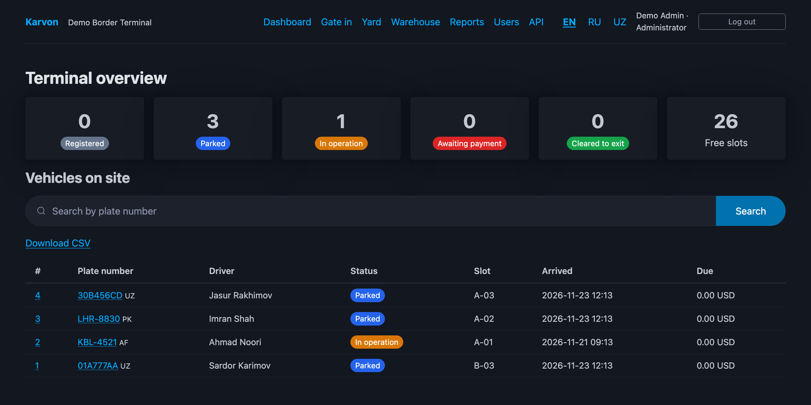
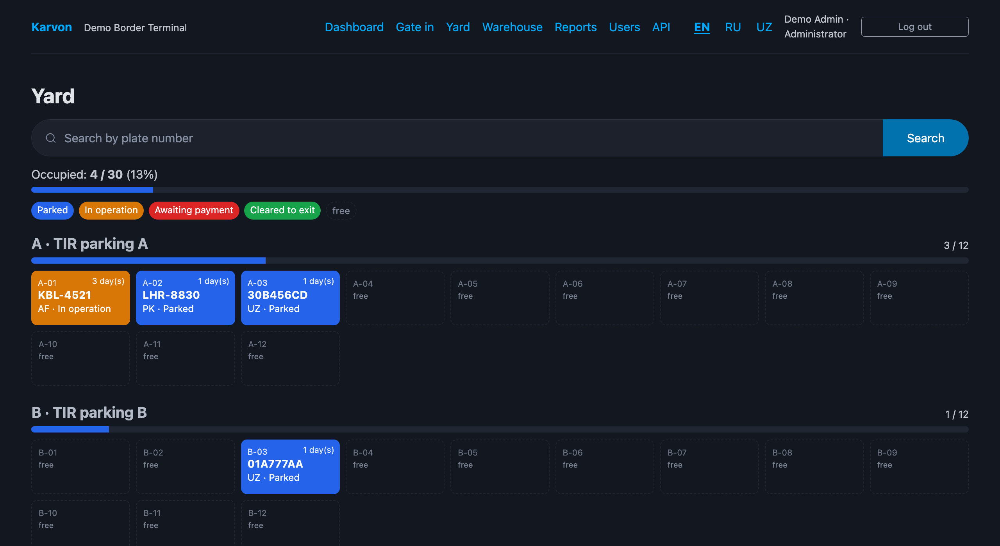
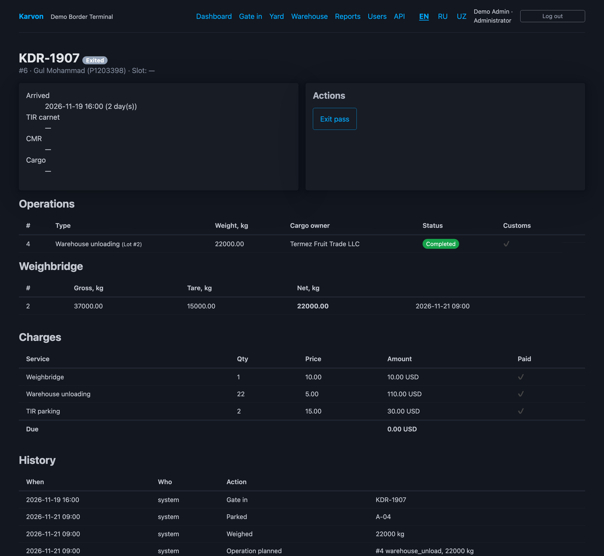
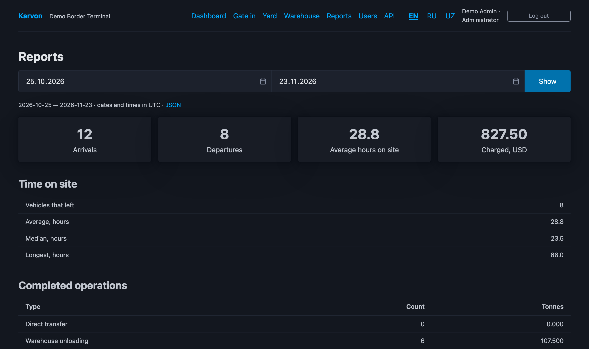
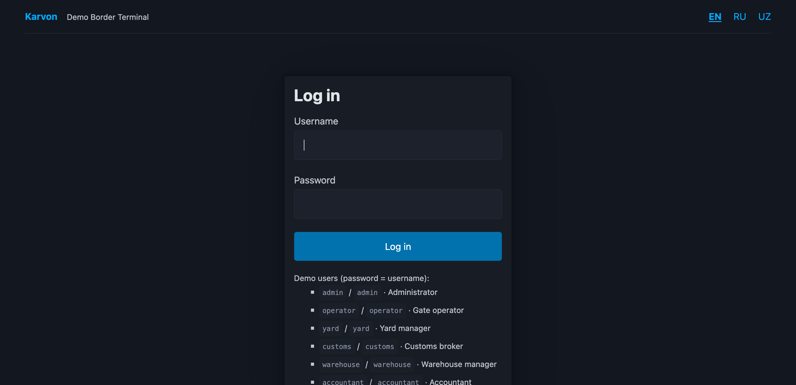
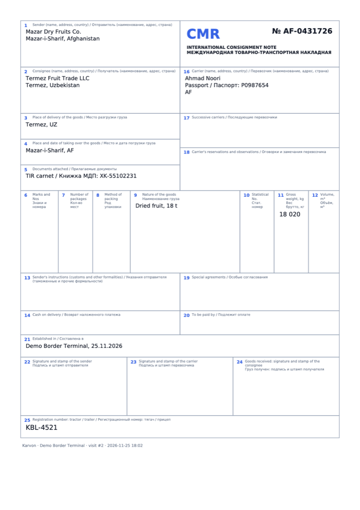

# Karvon

[](https://github.com/Khan-ipak/karvon/actions/workflows/ci.yml)
[](https://github.com/Khan-ipak/karvon/releases)
[](LICENSE)
[](pyproject.toml)
[](https://github.com/Khan-ipak/karvon/discussions)

**English** · [Русский](README.ru.md)

**[▶ Try the live demo](https://karvon-demo.onrender.com)**: log in as `admin` / `admin`, or as
`customs` / `customs` to see what a customs broker sees. The first visit can take up to a minute
while the free server wakes up; the data resets regularly.

**Open-source Terminal Operating System for land freight terminals.**
Built for dry ports, border truck terminals, TIR parks and cross-dock warehouses.

*Karvon* means "caravan" in Uzbek. The project started at a border terminal on the
Uzbekistan–Afghanistan crossing, where trucks from Afghanistan and Pakistan are
parked, transloaded, weighed, cleared and released every day.

> **Status: alpha (v0.3).** The core visit flow works end to end, with users, roles, reports and PDF documents. Feedback and
> contributors are very welcome. See the [roadmap](#roadmap).



<table>
  <tr>
    <td></td>
    <td></td>
  </tr>
  <tr>
    <td align="center"><sub>Yard map: click a free slot to park a truck</sub></td>
    <td align="center"><sub>Truck visit: weighing, charges and who did what</sub></td>
  </tr>
  <tr>
    <td></td>
    <td></td>
  </tr>
  <tr>
    <td align="center"><sub>Reports: throughput, time on site, revenue</sub></td>
    <td align="center"><sub>One login per role: gate, yard, customs, warehouse, accountant</sub></td>
  </tr>
</table>

<p align="center"><sub>Interface in English, Russian and Uzbek. <a href="docs/img/dashboard-ru.png">Russian screenshot</a></sub></p>

## Why

Container seaports have plenty of terminal software. Land terminals mostly run on
spreadsheets, paper and expensive closed systems. Karvon gives them a free,
self-hosted system that models how a truck terminal really works:

- **Gate in / gate out.** Vehicle, driver, TIR carnet and CMR are registered at the gate.
- **Yard.** Zones and slots, automatic or manual slot assignment, a live yard board.
- **Operations.** Direct transfer (truck to truck), warehouse unloading and warehouse loading.
- **Warehouse.** Stock lots per cargo owner, created by unloads and consumed by loads.
- **Customs flag.** Customs can be cleared before *or* after the physical work.
- **Weighbridge.** Gross, tare and net weigh tickets.
- **Billing.** Configurable tariffs for parking per day, per tonne and per service.
  A truck can't leave until everything is done, cleared and paid.
- **Documents.** A filled CMR consignment note and an invoice as PDF, ready to print.
- **Multilingual.** English, Russian and Uzbek are included. Add a language with one JSON file.
- **REST API** with OpenAPI docs at `/docs`, so you can connect cameras, scales or your ERP.

## Quick start

With Docker:

```bash
git clone https://github.com/Khan-ipak/karvon.git
cd karvon
docker compose up
```

Open <http://localhost:8000>. A demo terminal with trucks in different stages is
created on first start, with one demo user per role. The password is the
username: log in as `admin` / `admin`, or as `customs` / `customs` to see what a
customs broker sees.

Your own public demo on [Render](https://render.com)'s free plan, in a few clicks:

[](https://render.com/deploy?repo=https://github.com/Khan-ipak/karvon)

It uses [`render.yaml`](render.yaml): SQLite on a temporary disk, so the demo
starts from fresh data after every restart, and `KARVON_PUBLIC_DEMO=1`, so
visitors can't change the shared demo logins.

Without Docker (uses SQLite):

```bash
python -m venv .venv && source .venv/bin/activate
pip install -e ".[dev]"
uvicorn karvon.main:app --reload
```

## Users and roles

Every action is done by a logged-in user, and every visit keeps a history of
who did what and when.

| Role         | Can                                                     |
|--------------|---------------------------------------------------------|
| `operator`   | Gate in, plan operations, weigh, request exit, gate out, reports |
| `yard`       | Park vehicles, weigh                                    |
| `customs`    | Mark operations as customs cleared                      |
| `warehouse`  | Start, complete and cancel operations                   |
| `accountant` | Take payment, reports                                   |
| `admin`      | Everything, plus managing users                         |

Everyone who is logged in can view visits, the yard and stock. The API accepts
the browser session or HTTP Basic auth:

```bash
curl -u operator:operator http://localhost:8000/api/v1/visits
```

For a real terminal, turn off demo data and create your own admin:

```bash
KARVON_SEED_DEMO=0 KARVON_ADMIN_PASSWORD='a long password' uvicorn karvon.main:app
# or, any time later:
python -m karvon.users create admin --role admin
```

## Reports

`/reports` (and `GET /api/v1/reports?from=2026-11-01&to=2026-11-30`) shows, for
any period up to a year:

- arrivals and departures per day;
- time on site of the vehicles that left: average, median, longest;
- completed operations by type, in tonnes;
- charges by service, paid and unpaid.

## Documents

Every visit page has a **CMR (PDF)** button, and an **Invoice (PDF)** button once
there are charges:

- **CMR consignment note** with the standard numbered boxes 1–25, labelled in
  English and Russian: sender, consignee, places of loading and delivery, TIR
  carnet, goods, gross weight from the weigh ticket, carrier and plate numbers.
  Fill in the shipping details at the gate or later on the visit page.
- **Invoice** for the visit's charges in the user's language, with paid and due
  amounts. Set `KARVON_TERMINAL_ADDRESS` to print your address and tax number on it.

<p align="center"></p>

The same PDFs are in the API: `GET /api/v1/visits/{id}/cmr.pdf` and
`GET /api/v1/visits/{id}/invoice.pdf?lang=ru`.

## How a visit flows

```
gate in → park → plan operation → (customs) → start → complete → weigh
        → request exit → pay → gate out
```

The rules live in [`karvon/services.py`](karvon/services.py). The domain model and
lifecycle are in [`docs/architecture.md`](docs/architecture.md).

## Configuration

| Variable                  | Default                  | Description                      |
|---------------------------|--------------------------|----------------------------------|
| `KARVON_DATABASE_URL`     | `sqlite:///./karvon.db`  | Any SQLAlchemy URL (PostgreSQL recommended) |
| `KARVON_SEED_DEMO`        | `1`                      | Create demo trucks and demo users (password = username) on an empty database. **Set to `0` in production** |
| `KARVON_PUBLIC_DEMO`      | `0`                      | Public demo: shows a banner and blocks changes to users and passwords |
| `KARVON_ADMIN_PASSWORD`   | —                        | On startup, create user `KARVON_ADMIN_USERNAME` (default `admin`) with this password if it doesn't exist |
| `KARVON_TERMINAL_NAME`    | `Demo Border Terminal`   | Shown in the UI                  |
| `KARVON_DEFAULT_LANGUAGE` | `en`                     | `en`, `ru`, `uz`, …              |
| `KARVON_CURRENCY`         | `USD`                    | Display currency                 |
| `KARVON_TERMINAL_ADDRESS` | —                        | Address and tax number printed on invoices (`\n` for a new line) |
| `KARVON_TIMEZONE`         | `UTC`                    | Terminal time zone (IANA name, e.g. `Asia/Tashkent`). Times are shown and reports are grouped by day in it |

## Roadmap

- [x] Gate, yard, operations, warehouse, weighbridge, billing
- [x] EN / RU / UZ interface
- [x] Users, roles and audit log
- [x] Database migrations (Alembic)
- [ ] Weighbridge hardware driver (RS-232 / TCP)
- [ ] ANPR camera at the gate
- [x] Reports: dwell time, throughput, revenue
- [x] Yard map
- [x] CMR and invoice PDFs
- [ ] More languages: Turkish, Dari, Pashto, Kazakh, Tajik

Have a terminal with a different process? [Open an issue](https://github.com/Khan-ipak/karvon/issues).
Real-world processes shape the roadmap.

## Contributing

See [CONTRIBUTING.md](CONTRIBUTING.md). Translating the UI is a great first contribution.

## License

[MIT](LICENSE)
