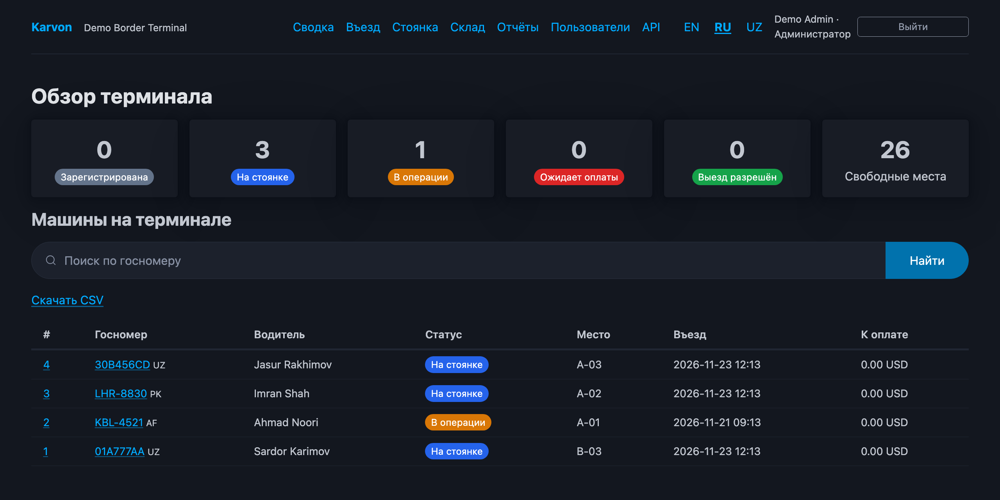
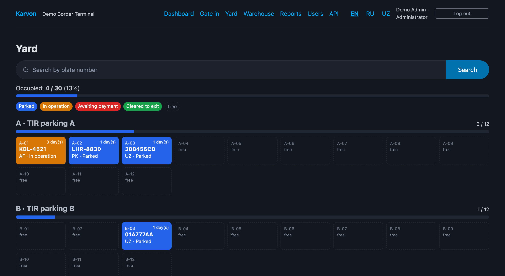
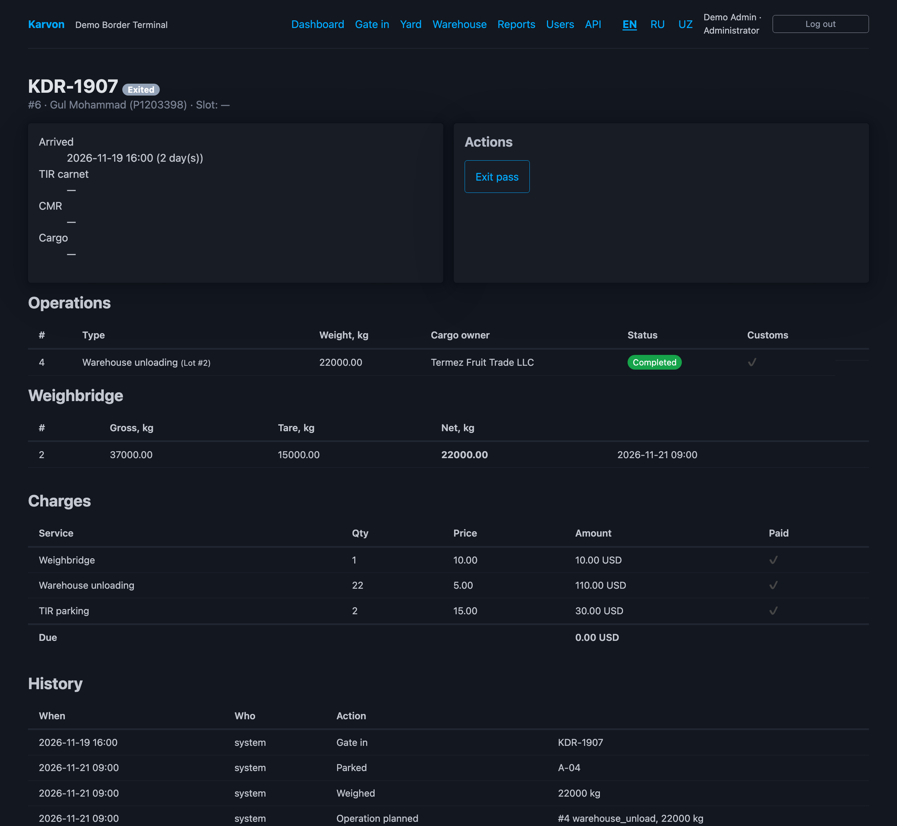
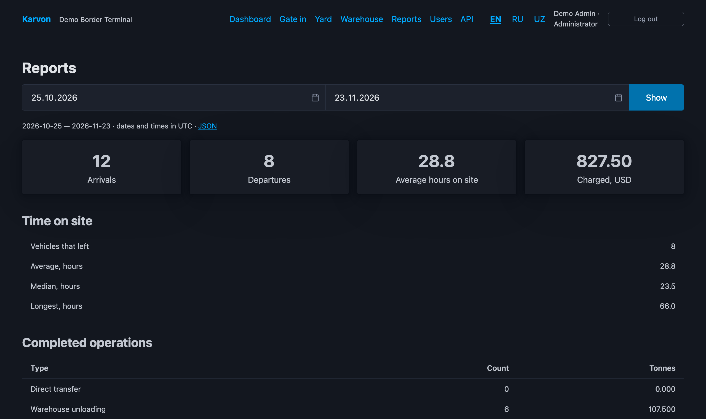
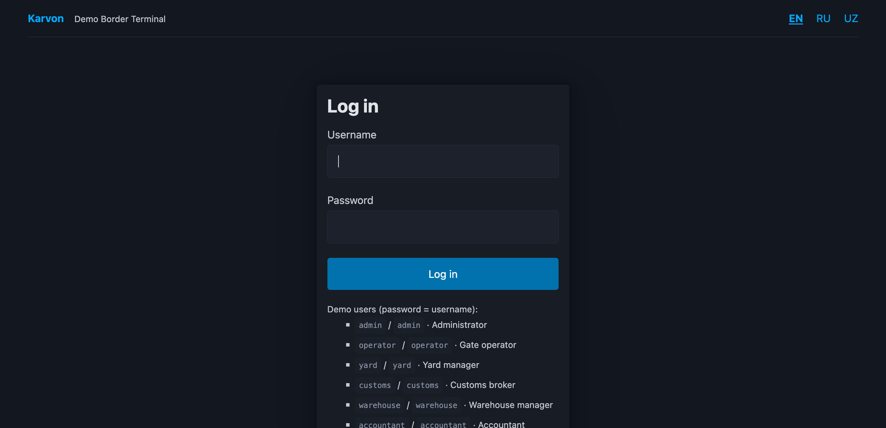
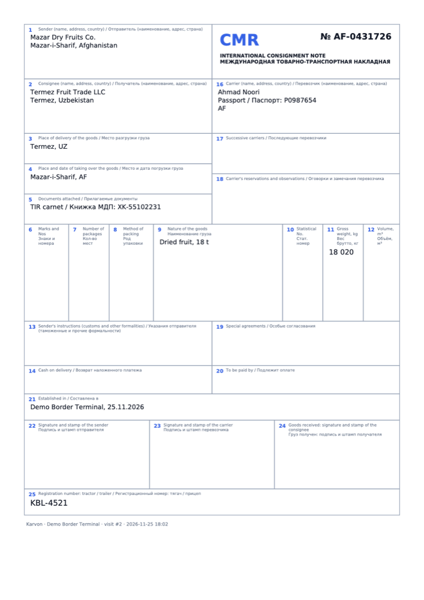

# Karvon

[](https://github.com/Khan-ipak/karvon/actions/workflows/ci.yml)
[](https://github.com/Khan-ipak/karvon/releases)
[](LICENSE)
[](pyproject.toml)

[English](README.md) · **Русский**

**[▶ Онлайн-демо](https://karvon-demo.onrender.com)**: войдите как `admin` / `admin` или как
`customs` / `customs`, чтобы увидеть, что видит таможенный брокер. Первое открытие может занять
до минуты, пока бесплатный сервер просыпается; данные регулярно сбрасываются.

**Открытая система управления сухопутным грузовым терминалом (TOS).**
Для сухих портов, пограничных автотерминалов, стоянок МДП (TIR) и кросс-док складов.

*Karvon* по-узбекски значит «караван». Проект начался на пограничном терминале на
переходе Узбекистан–Афганистан. Туда каждый день приходят фуры из Афганистана и
Пакистана: их ставят на стоянку, перегружают, взвешивают, оформляют на таможне и
выпускают.

> **Статус: альфа (v0.2).** Весь путь машины работает от въезда до выезда, есть
> пользователи, роли и отчёты. Отзывы и помощь очень нужны, см. [план](#план).



<table>
  <tr>
    <td></td>
    <td></td>
  </tr>
  <tr>
    <td align="center"><sub>Карта стоянки: нажмите на свободное место, чтобы поставить машину</sub></td>
    <td align="center"><sub>Визит: взвешивание, начисления и кто что сделал</sub></td>
  </tr>
  <tr>
    <td></td>
    <td></td>
  </tr>
  <tr>
    <td align="center"><sub>Отчёты: поток машин, время на терминале, выручка</sub></td>
    <td align="center"><sub>Свой вход у каждой роли: КПП, стоянка, таможня, склад, бухгалтерия</sub></td>
  </tr>
</table>

<p align="center"><sub>Интерфейс на русском, узбекском и английском. Скриншоты выше на английском.</sub></p>

## Зачем

Для морских контейнерных портов программ много. Сухопутные терминалы в основном
живут в Excel, на бумаге или в дорогих закрытых системах. Karvon даёт им
бесплатную систему на своём сервере, которая повторяет реальную работу
автотерминала:

- **Въезд и выезд.** На КПП регистрируются машина, водитель, книжка МДП и CMR.
- **Стоянка.** Зоны и места, автоматическая или ручная расстановка, карта стоянки.
- **Операции.** Прямая перегрузка с машины на машину, выгрузка на склад и погрузка со склада.
- **Склад.** Партии по владельцам груза: создаются при выгрузке, списываются при погрузке.
- **Таможня.** Отметку об оформлении можно поставить до или после физической операции.
- **Весовая.** Талоны брутто, тара, нетто.
- **Расчёты.** Тарифы за стоянку в сутки, за тонну и за услугу. Машина не выедет,
  пока всё не сделано, не оформлено и не оплачено.
- **Документы.** Заполненная CMR и счёт на оплату в PDF, готовые к печати.
- **Языки.** Русский, узбекский и английский. Новый язык — это один JSON-файл.
- **REST API** с документацией на `/docs`: можно подключить камеры, весы или вашу ERP.

## Быстрый старт

С Docker:

```bash
git clone https://github.com/Khan-ipak/karvon.git
cd karvon
docker compose up
```

Откройте <http://localhost:8000>. При первом запуске создаётся демо-терминал с
машинами на разных этапах и по одному пользователю на каждую роль. Пароль
совпадает с логином: войдите как `admin` / `admin` или как `customs` / `customs`,
чтобы увидеть, что видит таможенный брокер. Язык переключается в правом верхнем углу.

Своё публичное демо на бесплатном тарифе [Render](https://render.com) в несколько кликов:

[](https://render.com/deploy?repo=https://github.com/Khan-ipak/karvon)

Без Docker (на SQLite):

```bash
python -m venv .venv && source .venv/bin/activate
pip install -e ".[dev]"
uvicorn karvon.main:app --reload
```

## Пользователи и роли

Любое действие делает конкретный пользователь, и у каждого визита есть история:
кто, что и когда сделал.

| Роль         | Может                                                               |
|--------------|---------------------------------------------------------------------|
| `operator`   | Въезд, планирование операций, взвешивание, запрос выезда, выезд, отчёты |
| `yard`       | Ставить машины на места, взвешивание                                |
| `customs`    | Отмечать таможенное оформление операций                             |
| `warehouse`  | Начинать, завершать и отменять операции                             |
| `accountant` | Принимать оплату, отчёты                                            |
| `admin`      | Всё, плюс управление пользователями                                 |

Смотреть визиты, стоянку и склад может любой вошедший пользователь. API
принимает сессию браузера или HTTP Basic:

```bash
curl -u operator:operator http://localhost:8000/api/v1/visits
```

Для настоящего терминала отключите демо-данные и создайте своего админа:

```bash
KARVON_SEED_DEMO=0 KARVON_ADMIN_PASSWORD='длинный пароль' uvicorn karvon.main:app
# или в любой момент позже:
python -m karvon.users create admin --role admin
```

## Отчёты

`/reports` (и `GET /api/v1/reports?from=2026-11-01&to=2026-11-30`) за любой период до года:

- въезды и выезды по дням;
- время на терминале выехавших машин: среднее, медиана, максимум;
- завершённые операции по типам, в тоннах;
- начисления по услугам: оплачено и не оплачено.

## Документы

На странице каждого визита есть кнопка **CMR (PDF)**, а когда появились
начисления, ещё и **Счёт (PDF)**:

- **CMR (международная товарно-транспортная накладная)** со стандартными графами
  1–25 на английском и русском: отправитель, получатель, места погрузки и
  разгрузки, книжка МДП, груз, вес брутто по талону взвешивания, перевозчик и
  номера тягача и прицепа. Данные перевозки заполняются на КПП или позже на
  странице визита.
- **Счёт** на начисления визита на языке пользователя, с оплаченной суммой и
  суммой к оплате. Чтобы на счёте были ваш адрес и ИНН, задайте `KARVON_TERMINAL_ADDRESS`.

<p align="center"></p>

Те же PDF есть в API: `GET /api/v1/visits/{id}/cmr.pdf` и
`GET /api/v1/visits/{id}/invoice.pdf?lang=ru`.

## Путь машины

```
въезд → стоянка → план операции → (таможня) → начало → завершение → взвешивание
      → запрос выезда → оплата → выезд
```

Правила собраны в [`karvon/services.py`](karvon/services.py). Модель данных и
жизненный цикл описаны в [`docs/architecture.md`](docs/architecture.md) (на английском).

## Настройки

| Переменная                | По умолчанию             | Что делает                       |
|---------------------------|--------------------------|----------------------------------|
| `KARVON_DATABASE_URL`     | `sqlite:///./karvon.db`  | Любой URL SQLAlchemy (рекомендуем PostgreSQL) |
| `KARVON_SEED_DEMO`        | `1`                      | Создать демо-машины и демо-пользователей (пароль = логин) в пустой базе. **На рабочем терминале ставьте `0`** |
| `KARVON_PUBLIC_DEMO`      | `0`                      | Публичное демо: баннер и запрет менять пользователей и пароли |
| `KARVON_ADMIN_PASSWORD`   | —                        | При запуске создать пользователя `KARVON_ADMIN_USERNAME` (по умолчанию `admin`) с этим паролем, если его нет |
| `KARVON_TERMINAL_NAME`    | `Demo Border Terminal`   | Название в интерфейсе            |
| `KARVON_DEFAULT_LANGUAGE` | `en`                     | `en`, `ru`, `uz`, …              |
| `KARVON_CURRENCY`         | `USD`                    | Валюта в интерфейсе              |
| `KARVON_TERMINAL_ADDRESS` | —                        | Адрес и ИНН на счетах (`\n` — новая строка) |
| `KARVON_TIMEZONE`         | `UTC`                    | Часовой пояс терминала (имя IANA, например `Asia/Tashkent`). В нём показывается время и считаются дни в отчётах |

## План

- [x] Въезд, стоянка, операции, склад, весовая, расчёты
- [x] Интерфейс на русском, узбекском и английском
- [x] Пользователи, роли и журнал действий
- [x] Миграции базы (Alembic)
- [x] Отчёты: время на терминале, поток машин, выручка
- [x] Карта стоянки
- [x] CMR и счета в PDF
- [ ] Подключение весов (RS-232 / TCP)
- [ ] Камера с распознаванием номеров на въезде
- [ ] Больше языков: турецкий, дари, пушту, казахский, таджикский

У вас терминал с другим процессом? [Опишите его в issue](https://github.com/Khan-ipak/karvon/issues),
можно на русском. План строится по реальным процессам.

## Как помочь

См. [CONTRIBUTING.md](CONTRIBUTING.md). Перевод интерфейса — отличный первый вклад.
Вопросы и обсуждения можно писать на русском.

## Лицензия

[MIT](LICENSE)
